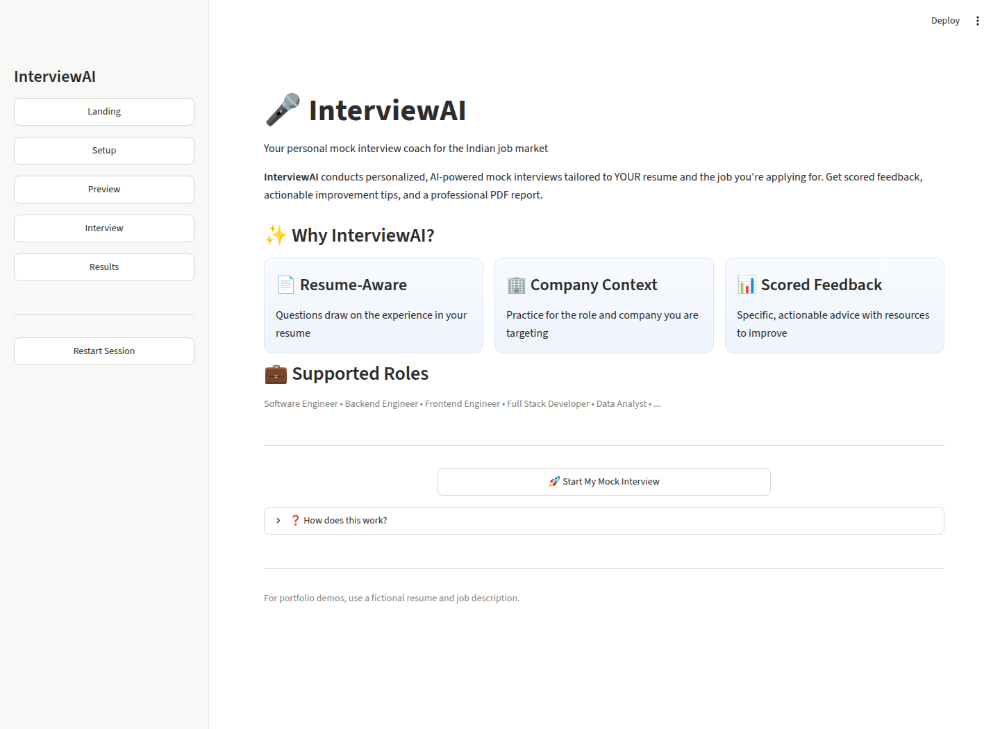
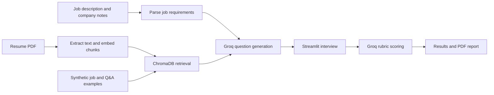

# InterviewAI

InterviewAI turns a text-based resume and a target job description into a personalized mock interview. Candidates practice written answers, review rubric-based feedback, and download a PDF to guide their next practice session.

## Demo



See the [resume and job input screen](docs/screenshots/02-resume-and-job-input.png) and a [PDF report rendered from test scores](docs/screenshots/03-sample-report.png).

Use the [90-second walkthrough](docs/demo/README.md), [fictional resume](docs/demo/mira-vale-resume.pdf), and [fictional job brief](docs/demo/job-description.md).

## Features

- Resume PDF extraction, job description analysis, and optional company context
- Five, eight, or ten questions with selectable difficulty and interview focus
- Profile preview, generated question list, and a guided interview with optional hints
- Per-question relevance, depth, and clarity scores, improvement suggestions, and a downloadable PDF

## Architecture



Streamlit manages the interface and interview state. PyPDF2 extracts resume text. Sentence Transformers encodes text for ChromaDB similarity search. LangChain connects prompt templates to Groq. Python validates the generated question list and scoring payload before the UI displays them. fpdf2 generates the report.

## Local setup

Use Python 3.12 for the standard install. Python 3.15 was tested for dependency resolution and could not install ChromaDB because its ONNX Runtime dependency had no compatible release in the tested package index.

```bash
python3.12 -m venv venv
venv/bin/python -m pip install -r requirements.txt
venv/bin/python data_processing/generate_synthetic_datasets.py
```

On Windows, use `py -3.12 -m venv venv` and replace `venv/bin/python` with `venv\Scripts\python.exe`.

The generator writes `data/interview_qa.csv` and `data/indian_jd_dataset.json`. Run it on a fresh checkout. It overwrites these paths if files already exist.

Create an ignored `.env` file in the repository root and set `GROQ_API_KEY` to your Groq API key. You can optionally set `GROQ_MODEL` to a model available to your account. Start the app from the repository root.

```bash
venv/bin/python -m streamlit run app.py --server.address 127.0.0.1
```

Open `http://127.0.0.1:8501`. The first interview may download the embedding model and index the reference datasets.

ChromaDB defaults to `chroma_store/`. If the repository is on a mounted drive that causes SQLite write errors, set `INTERVIEWAI_CHROMA_DIR` to a private directory on a local filesystem before launching.

## Tests

```bash
venv/bin/python -m pytest -q
```

The suite covers PDF extraction, retrieval contracts, question generation, interview state, rubric validation, and report generation. The [demo walkthrough](docs/demo/README.md) exercises the browser flow and requires a Groq key.

## Known limitations

- Scanned or encrypted PDFs require a readable, text-based export before upload.
- Groq receives candidate text, job context, and interview answers. ChromaDB and generated reports remain on local disk after restarting a session. Use fictional data for demonstrations.
- Reference examples are synthetic. Treat company context and AI scoring as practice guidance.
- The PDF uses a Latin-1 font. Unsupported characters are replaced. Service availability, model changes, and rate limits can affect generation.
